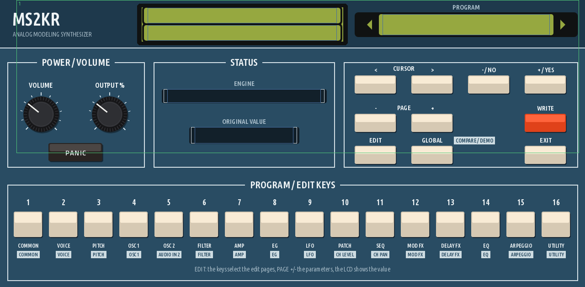
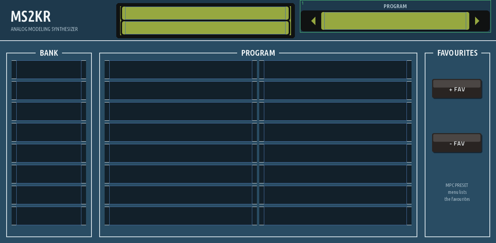

# MS2KR for MPC (Gen2)

The MS2000R analog-modeling synthesizer as a native instrument plugin for **Akai MPC Gen2 standalone devices** (MPC Live III
and other aarch64 models), with a touchscreen skin laid out like the real front panel and Q-Link control on every page.

It is not a re-creation of the sound: it runs the synthesizer's **own firmware**. The main CPU (Hitachi H8S/2350) and the
DSP (Motorola DSP56362) are emulated by [ms2000r-emu](https://github.com/Tuth/ms2000r-emu), so programs, the vocoder,
the arpeggiator, the mod sequencer and the effects behave as on the hardware.



## What you need

- An MPC Gen2 device (MPC Live III class, 64-bit ARM). Gen1 devices (MPC Live/One/X, Force) are **not** supported: the
  emulation needs the Gen2 CPU.
- **Your own ROM dumps** from an MS2000 or MS2000R. They are not included and never will be:

  | File | What | Where it comes from |
  |---|---|---|
  | `flash.bin` | the 1 MB main flash (firmware, waveforms, programs) | read from your unit with the *MS2000 Flash Tool* in the [ms2000r-emu release](https://github.com/Tuth/ms2000r-emu/releases) (Windows, over MIDI). **Never use it on an MS2000B / MS2000BR.** |
  | `boot-362.bin` | the DSP56362 boot ROM (768 bytes) | see the ms2000r-emu README; `boot-362.ms2000.bin` (the corrected copy) is used first if present |

  The official firmware updater alone is not enough: it holds only the first 256 KB of the flash.

## Installing

1. Install the plugin folder on your MPC (release zips and the plugin catalog entry will follow; until then build it
   yourself, see *Building* below).
2. Copy your `flash.bin` and `boot-362.bin` into the plugin's `Content/roms/` folder.
3. Add **MS2KR** to a track. The machine boots in the background for a few seconds; the LCD at the top shows
   *booting*, then the first program (A01).

## Using it

The LCD and the program selector are at the top of every page. Like the hardware, **knobs show no number: the LCD shows
the value** of whatever you turn. LEDs are shown as red text under their keys (wave, filter type, LFO shape, ...).

| Page | What is on it |
|---|---|
| **PLAY** | volume, output level, panic, engine status (with a dropout counter), the edit keys (cursor, page, -/NO, +/YES, EDIT, GLOBAL, WRITE, EXIT) and the 16 program keys, which select the edit pages in EDIT mode |
| **BANKS** | banks A-H and the 16 programs of the selected bank, by name; **+ FAV / - FAV** |
| **OSC** | oscillator 1 and 2, mixer, portamento, timbre select |
| **FILTER / EG** | filter, amp, EG 1, EG 2 |
| **LFO / FX / PATCH** | both LFOs, the effects, the virtual patch |
| **ARP / SEQ** | arpeggiator, mod sequence, keyboard mode, bank/octave |



- **Favourites:** + FAV saves the sound as it is now, knob tweaks included, from any bank. Favourites appear in MPC's own
  preset menu for the plugin; - FAV removes the selected one. They are kept in the plugin folder.
- **Projects** store the current sound (the whole edit buffer) and the panel, so a project sounds the same when you load it.
- **The machine's memory** behaves like the hardware's: programs you store with WRITE and the GLOBAL settings stay in the
  plugin folder (`Content/memory/`), shared by every project. Your `flash.bin` itself is never changed.
- **MIDI:** notes and controllers arrive on whatever channel the track sends; the plugin moves them to the machine's Global
  MIDI channel. Program changes from MPC select programs A01-H16.
- Keys are momentary taps. Two-key combinations that must be held (EXIT + GLOBAL for the demo songs) are not possible
  from the touchscreen.

## Performance

About 60% of one fast core for the main CPU emulation plus a second thread for the DSP, measured on an MPC Live III. The
plugin runs its emulation on the fast cores, ~17 ms ahead of the audio, and prepares for program changes (which make the
DSP code reload) by running further ahead first, so browsing programs while playing does not drop out. One instance per
project.

## Building

Linux with Docker. Uses [mpc-vst-plugins](https://github.com/sd88me/mpc-vst-plugins) (`MPC_VST`, default
`~/mpc-vst-plugins`) and an unpacked `libasound2-dev:arm64` (`ALSA_ROOT_A64`):

```
./build.sh test                 # x86 engine test (MS2K_TEST_DIR=<dir with roms/>)
./build.sh all                  # aarch64 engine + skin + ms2kr.so in vst/build/aarch64/
DEVICE=root@<mpc> ./build.sh pgo-train   # optional: profile-guided build trained on the device (~20% less CPU)
tools/preview.sh                # offline skin preview: vst/preview/page_N.png
```

The skin is drawn by `tools/make_skin.py`; the engine is `src/dsp/ms2k_engine.cpp`. The emulator is vendored in
`src/ms2000r-emu` with two small arm64 changes, listed in `src/VENDORED.md`.

## Credits and licence

- [ms2000r-emu](https://github.com/Tuth/ms2000r-emu) by Tuth (GPL-3.0): the emulator, and the panel layout the skin follows.
- [dsp56300](https://github.com/dsp56300/dsp56300) by The Usual Suspects (GPL-3.0), part of gearmulator: the DSP56300 emulation.
- Ubuntu Sans font (Ubuntu Font Licence), used in the skin artwork.
- Plugin framework and skin tools: [mpc-vst-plugins](https://github.com/sd88me/mpc-vst-plugins).

This plugin is licensed under the GPL-3.0 (see `LICENSE`). It is an independent project, not affiliated
with or endorsed by Korg or Akai. MS2000 and MS2000R are trademarks of their owners and are used here only to say which
hardware the emulation runs the firmware of.
