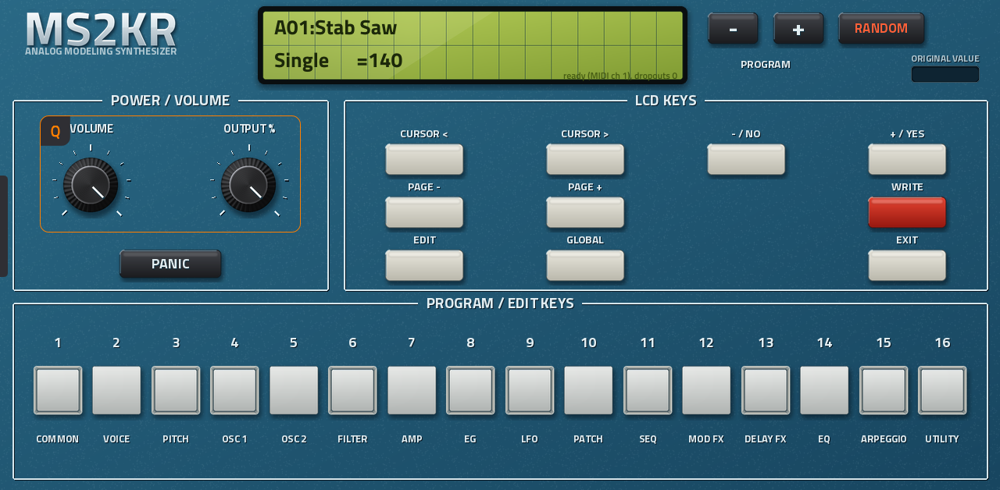
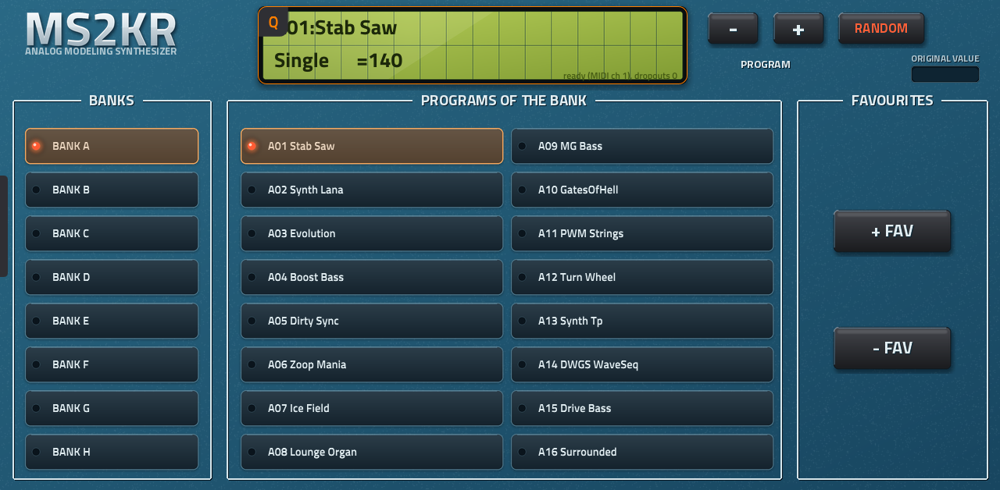
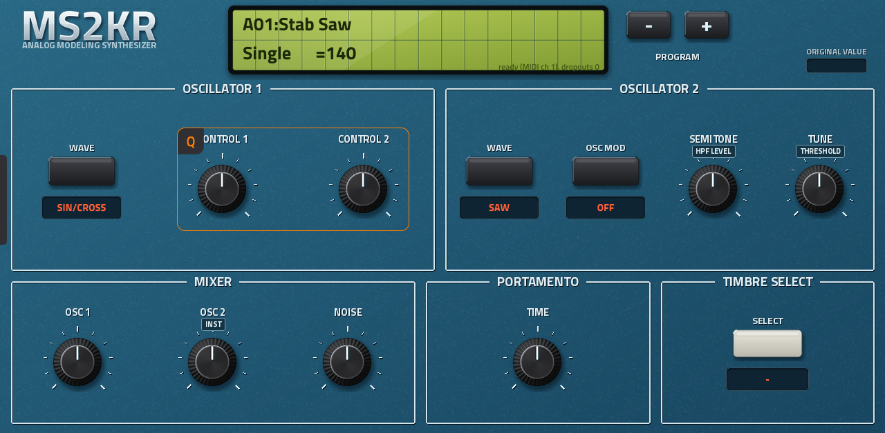
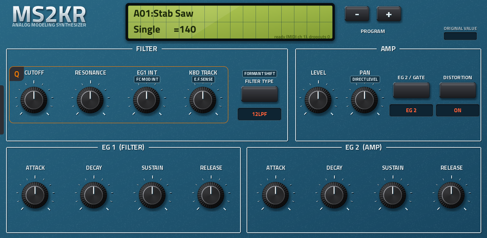
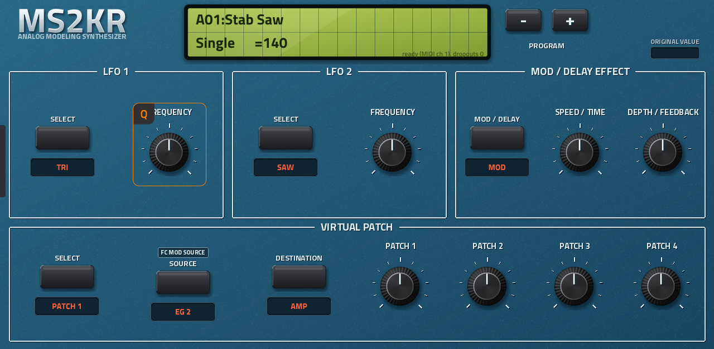
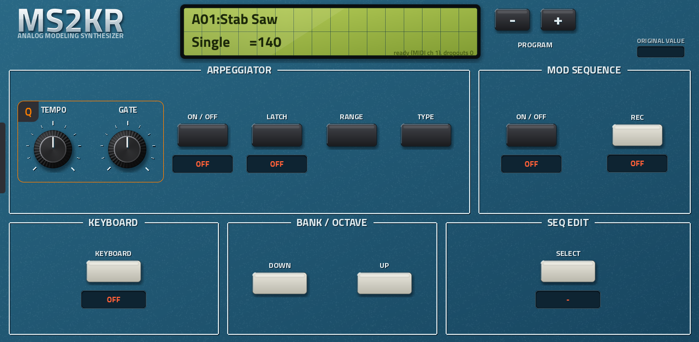

# MS2KR for MPC (Gen2)

The MS2000R analog-modeling synthesizer as a native instrument plugin for **Akai MPC Gen2 standalone devices** (MPC Live III
and other aarch64 models), with a touchscreen skin laid out like the real front panel and Q-Link control on every page.

It is not a re-creation of the sound: it runs the synthesizer's **own firmware**. The main CPU (Hitachi H8S/2350) and the
DSP (Motorola DSP56362) are emulated by [ms2000r-emu](https://github.com/Tuth/ms2000r-emu), so programs, the vocoder,
the arpeggiator, the mod sequencer and the effects behave as on the hardware.



*(Screenshots from an MPC Live III. The orange frame and "Q" tag mark the active Q-Link group.)*

## What you need

- An MPC Gen2 device (MPC Live III class, 64-bit ARM). Gen1 devices (MPC Live/One/X, Force) are **not** supported: the
  emulation needs the Gen2 CPU.
- **Your own ROM dumps** from an MS2000 or MS2000R. They are not included and never will be:

  | File | What | Where it comes from |
  |---|---|---|
  | `flash.bin` | the 1 MB main flash (firmware, waveforms, programs) | read from your unit with the *MS2000 Flash Tool* in the [ms2000r-emu release](https://github.com/Tuth/ms2000r-emu/releases) (Windows, over MIDI). **Never use it on an MS2000B / MS2000BR.** |
  | `boot-362.bin` | the DSP56362 boot ROM (768 bytes) | see the ms2000r-emu README; `boot-362.ms2000.bin` (the corrected copy) is used first if present |

  The official firmware updater alone is not enough: it holds only the first 256 KB of the flash.

## Installing

There are two plugin formats. Use one of them, not both: they are the same plugin.

| Plugin format | Zip | How it is installed | Plugin folder |
|---|---|---|---|
| **SDK format** (MPC OS 3.10.1 or later) | `MS2KR-<version>-mpc-sdk.zip` | By hand: unzip it, copy the folder `sd88me - VST - MS2KR` into `VST2 Plugins` at the root of a drive the MPC can see, turn on **Preferences > Enhancements (Beta) > Enable Enhancements** and **External Plugin Support**, and restart the MPC | `VST2 Plugins/sd88me - VST - MS2KR/` on that drive |
| **Older format** (plugins listed in `MPC.settings`) | `MS2KR-<version>-mpc-aarch64.zip` | With the **OpenMPC Plugin Manager**, or by hand over SSH with the zip's `install.sh` (needs root access; on a Live III add `-t /nvme/Synths`) | `sd88me - VST - MS2KR/` in the Synths folder it was installed to |

The zips are on the [releases](https://github.com/sd88me/mpc-vst-ms2kr/releases) page.

### Adding your ROMs
Copy `flash.bin` and `boot-362.bin` into the plugin folder's `Content/roms/` (make the folder if it isn't there), for example
`VST2 Plugins/sd88me - VST - MS2KR/Content/roms/`. Use USB, `scp` or the MPC's file browser. This is the same for both formats:
the OpenMPC Plugin Manager has no ROM step for MS2KR, so copy the files by hand after installing.

Then add **MS2KR** to a track. The machine boots in the background for a few seconds; the LCD at the top shows *booting*, then
the first program.

### Upgrading
- **SDK format:** copy the new folder over the old one (merge it, don't delete the old folder first) so `Content/` (your ROMs, the
  machine's stored programs and your favourites) stays.
- **Older format:** the OpenMPC Plugin Manager and `install.sh` upgrade in place and keep your ROMs, the machine's stored programs
  and your favourites.

## Backing up your favourites and sounds

Your favourites and your own files are kept in the plugin folder on the MPC, not in your projects (a project keeps only the sound its
track uses). Back them up before you update the plugin or MPC OS, reset the device, or move to another MPC. These are the files to keep,
inside the plugin folder `sd88me - VST - MS2KR`:

| File or folder | What it holds |
|---|---|
| `Content/favourites.dat` | your favourites |
| `Content/memory/` | the machine's stored programs and GLOBAL settings |
| `Content/roms/` | your ROMs |

Your ROMs are yours to keep with your backup, but don't share them.

### Where the plugin folder is
It is in `VST2 Plugins` on one of the MPC's drives, or in a Synths folder (`/sdcard/Synths`, or `/nvme/Synths` on a Live III),
depending on how MS2KR was installed. Over SSH (root access), this prints its path:

```bash
ssh root@<device-ip> 'find /sdcard /nvme /media -maxdepth 3 -type d -name "sd88me - VST - MS2KR" 2>/dev/null'
```

### Backing up
- **The plugin folder is on an SD card or USB drive:** plug the drive into a computer and copy the files above to it.
- **Over SSH**, from a computer: this copies the whole plugin folder into one file, `ms2kr-backup.tar`. Put the folder that holds the
  plugin folder (the path above without its last part) in place of `<parent folder>`:

  ```bash
  ssh root@<device-ip> 'cd "<parent folder>" && tar cf - "sd88me - VST - MS2KR"' > ms2kr-backup.tar
  ```

### Restoring
Install MS2KR first (on the new device, or after the reset or update), then put back only the files above. Don't copy the whole
old folder over the new one: that would put the old version of the plugin back too.

- **From a drive:** copy the files back to the same places in the new plugin folder.
- **Over SSH:** unpack the backup on your computer and send the files back. List only the ones your backup has, and put the new
  plugin folder's path (found as above) in place of `<plugin folder>`:

  ```bash
  mkdir ms2kr-backup && tar xf ms2kr-backup.tar -C ms2kr-backup
  tar cf - -C "ms2kr-backup/sd88me - VST - MS2KR" "Content/favourites.dat" "Content/memory" "Content/roms" | ssh root@<device-ip> 'cd "<plugin folder>" && tar xf -'
  ```

Then remove MS2KR from its tracks and add it again (or reopen the project), so it reads the restored files.

## Using it

One green **LCD** is at the top of every page: the firmware's own two lines (program, parameter, value) with the engine
status (and its dropout count) under them. Like the hardware, **knobs show no number: the LCD shows the value** of
whatever you turn. The data wheel and a Q-Link over the LCD step the program; **PROGRAM - / +** and **RANDOM** (PLAY and BANKS)
sit beside it. LEDs are shown as amber text in a window under their keys (wave, filter type, LFO shape, ...). The small boxed
names on a knob are the panel's vocoder functions, printed where they differ from the main name.

| Page | What is on it |
|---|---|
| **PLAY** | volume, output level, panic, the LCD keys (cursor, page, -/NO, +/YES, EDIT, GLOBAL, WRITE, EXIT) and the 16 program keys: outside EDIT they pick program 1-16 of the current bank, in EDIT mode they pick the edit page |
| **BANKS** | banks A-H and the 16 programs of the selected bank, by name (the selected ones stay lit); **+ FAV / - FAV**, and **RANDOM** in the header |
| **OSC** | oscillator 1 and 2, mixer, portamento, timbre select |
| **FILTER / EG** | filter, amp, EG 1, EG 2 |
| **LFO / FX / PATCH** | both LFOs, the effects, the virtual patch |
| **ARP / SEQ** | arpeggiator, mod sequence, keyboard mode, bank/octave |



| | |
|---|---|
|  |  |
|  |  |

- **Favourites:** + FAV takes the sound as it is now, knob tweaks included, and opens an on-screen keyboard with its name (up to 20
  characters): edit it and SAVE. Favourites appear in MPC's own preset menu for the plugin; - FAV removes the selected one. They are
  kept in the plugin folder (`Content/favourites.dat`).
- **Projects** store the current sound (the whole edit buffer) and the panel, so a project sounds the same when you load it.
- **The machine's memory** behaves like the hardware's: programs you store with WRITE and the GLOBAL settings stay in the
  plugin folder (`Content/memory/`), shared by every project. Your `flash.bin` itself is never changed.
- **MIDI:** notes and controllers arrive on whatever channel the track sends; the plugin moves them to the machine's Global
  MIDI channel. Program changes from MPC select programs A01-H16.
- Keys are momentary taps. Two-key combinations that must be held (EXIT + GLOBAL for the demo songs) are not possible
  from the touchscreen.

## Performance

About 60% of one fast core for the main CPU emulation plus a second thread for the DSP, measured on an MPC Live III. The
plugin runs its emulation on the fast cores, ~17 ms ahead of the audio, and prepares for program changes (which make the
DSP code reload) by running further ahead first, so browsing programs while playing does not drop out. One instance per
project.

## Building

Linux with Docker. Uses [mpc-vst-plugins](https://github.com/sd88me/mpc-vst-plugins) (`MPC_VST`, default
`~/mpc-vst-plugins`) and an unpacked `libasound2-dev:arm64` (`ALSA_ROOT_A64`):

```
./build-sdk.sh test            # offline test under ASan/UBSan with your ROMs, then the plugin builder's host_sim
./build-sdk.sh                 # engine + ms2kr-arm64.so + skin in build/sdk/"sd88me - VST - MS2KR"
./build-sdk.sh beta            # the same as "MS2KR 2 Beta" with its own id, to install next to a release
tools/package_catalog.sh       # the release zips in dist/
tools/make_tui.py --preview    # offline skin preview: docs/skin-preview/<page>.png
./build.sh all                 # the 0.1 wrapper build (kept for reference)
DEVICE=root@<mpc> ./build.sh pgo-train   # optional: profile-guided engine trained on the device (~20% less CPU)
```

The skin is drawn from code by `tools/ms2k_art.py` and laid out by `tools/make_tui.py`; the front end is `src/MS2KRPlugin.cpp`;
the engine is `src/dsp/ms2k_engine.cpp`. The emulator is vendored in
`src/ms2000r-emu` with two small arm64 changes, listed in `src/VENDORED.md`.

## Credits and licence

- [ms2000r-emu](https://github.com/Tuth/ms2000r-emu) by Tuth (GPL-3.0): the emulator, and the panel layout the skin follows.
- [dsp56300](https://github.com/dsp56300/dsp56300) by The Usual Suspects (GPL-3.0), part of gearmulator: the DSP56300 emulation.
- Titillium Web font (SIL Open Font Licence), used in the skin artwork.
- Plugin framework and skin tools: [mpc-vst-plugins](https://github.com/sd88me/mpc-vst-plugins).

This plugin is licensed under the GPL-3.0 (see `LICENSE`). It is an independent project, not affiliated
with or endorsed by Korg or Akai. MS2000 and MS2000R are trademarks of their owners and are used here only to say which
hardware the emulation runs the firmware of.
